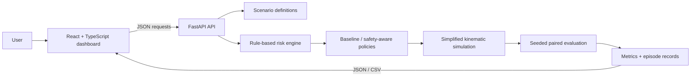

# DriveGuard AI — Responsible Autonomous Driving Simulator

An educational full-stack project for exploring safety, explainability, robustness, and ethical decision-making in autonomous-driving scenarios. It compares a transparent baseline rule policy with a safety-aware rule policy using a simplified deterministic kinematic simulation.

> **Safety notice:** This is not Tesla Autopilot, does not reproduce proprietary software, and is not a validated autonomous-driving controller. Do not use it for real-world driving or safety decisions.

## Project goals

- Simulate five driving scenarios with adjustable speed, obstacle distance, visibility, and policy.
- Explain a 0–100 rule-based risk score and the chosen driving action.
- Compare two policies on identical seeded episode inputs.
- Report collisions, near misses, emergency braking, reaction time, and stopping distance from episode records.
- Explore limits and trade-offs through a Responsible AI dashboard.

## Architecture



## Technology

- **Frontend:** React 18, TypeScript, Vite, CSS, Recharts, Fetch API.
- **Backend:** Python, FastAPI, Pydantic, Uvicorn.
- **Tests:** pytest, FastAPI TestClient.
- **Storage:** In-memory latest evaluation; CSV export. No database, paid API, external AI, or trained model.

## Project directory

```text
Res_ai/
├── README.md
├── .gitignore
├── backend/
│   ├── requirements.txt
│   ├── app/
│   │   ├── main.py             # FastAPI routes
│   │   ├── schemas.py          # Request/response validation
│   │   ├── scenarios.py        # Five scenario definitions
│   │   ├── risk_engine.py      # Explainable risk score
│   │   ├── driving_policy.py   # Baseline and safety-aware rules
│   │   ├── simulation.py       # Kinematic episode simulation
│   │   └── evaluation.py       # Paired experiments and metrics
│   └── tests/                  # Backend pytest suite
└── frontend/
    ├── package.json
    ├── package-lock.json
    ├── index.html
    └── src/
        ├── App.tsx             # Dashboard and application state
        ├── main.tsx            # React entry point
        ├── styles.css          # Responsive dashboard styling
        ├── components/         # Dashboard panels
        ├── services/api.ts     # Typed backend requests
        └── types/              # Shared TypeScript interfaces
```

## Run the application on Windows

### 1. Install the prerequisites

Install:

- **Python 3.11 or newer**
- **Node.js 18 or newer**, which includes npm
- **VS Code** or another editor/terminal

The project was verified with Python 3.13.5 and Node.js 22.16.0.

To check that Python and Node are available, open PowerShell and run:

```powershell
python --version
node --version
npm --version
```

If `python` is not recognized on Windows, install Python and select **Add Python to PATH** in the installer. Close and reopen PowerShell after installing it.

### 2. Open the project folder

In VS Code, select **File → Open Folder**, then open the folder containing this README. Or open PowerShell and change to the project directory:

```powershell
Set-Location "C:\Users\Lenovo\OneDrive - Anna University\Desktop\Res_ai"
```

If your project is stored elsewhere, replace that path with the folder that contains `README.md`, `backend`, and `frontend`.

### 3. Install backend dependencies (first run only)

In PowerShell, from the project root, create a Python virtual environment and install the backend packages:

```powershell
python -m venv .venv
.\.venv\Scripts\python.exe -m pip install -r backend\requirements.txt
```

You only need to do this once, or again after changing `backend\requirements.txt`. Using the virtual environment's Python directly avoids needing to activate it.

### 4. Install frontend dependencies (first run only)

Open a **second PowerShell terminal** in VS Code using **Terminal → New Terminal**, then run:

```powershell
Set-Location "C:\Users\Lenovo\OneDrive - Anna University\Desktop\Res_ai\frontend"
npm install
```

Replace the path if you keep the project in another location. You only need `npm install` once, or again after changing `frontend\package.json`.

### 5. Start the backend

In the first PowerShell terminal, change to the project root if needed, then start FastAPI:

```powershell
Set-Location "C:\Users\Lenovo\OneDrive - Anna University\Desktop\Res_ai"
.\.venv\Scripts\python.exe -m uvicorn backend.app.main:app --host 127.0.0.1 --port 8000
```

Keep this terminal open. The backend is running when the terminal reports that Uvicorn is running on port `8000`.

### 6. Start the frontend

In the second terminal, start Vite. Make sure this terminal is in the `frontend` folder:

```powershell
Set-Location "C:\Users\Lenovo\OneDrive - Anna University\Desktop\Res_ai\frontend"
npm run dev
```

Keep this terminal open too. Wait for Vite to display its `Local` URL.

### 7. Open and use the app

Open **http://localhost:5173** in a browser. The dashboard should show **Backend connected** near the top.

The app does not need an account or API key. Select a scenario, adjust the speed/distance/visibility controls, and run a simulation. Run the policy evaluation to populate the comparison, analytics, and CSV export. The first page load has empty metric cards until an evaluation has been run.

The backend can also be checked directly:

- Health check: <http://127.0.0.1:8000/api/health>
- Interactive API documentation: <http://127.0.0.1:8000/docs>
- Scenario data: <http://127.0.0.1:8000/api/scenarios>

### 8. Stop or restart the app

To stop a server, select its terminal and press **Ctrl+C**. Stop both servers when finished.

To run the app again, keep the terminals in their respective project folders and rerun only the backend and frontend start commands above. Do not rerun dependency installation unless packages have changed.

### Troubleshooting

| What you see | What to do |
| --- | --- |
| Browser cannot open the page | Confirm both server terminals are still running, then open `http://localhost:5173`. |
| Dashboard says **Backend offline** | Start/restart the backend on port `8000`; check `http://127.0.0.1:8000/api/health`. |
| `npm` or `python` is not recognized | Install Node.js or Python, ensure Python is added to PATH, then restart PowerShell. |
| `Cannot find module` or missing frontend packages | In the `frontend` folder run `npm install`, then restart Vite. |
| Backend packages are missing | From the project root run `.\.venv\Scripts\python.exe -m pip install -r backend\requirements.txt`. |
| Port 5173 is already in use | Stop the other frontend terminal with Ctrl+C. The project pins Vite to port 5173 and reports an error rather than silently switching to another port. |
| Page is blank or appears stale | Confirm Vite started successfully, reload the page, and check the terminal for compilation errors. |
| A link to `localhost:5173` gives 404 | Stop old Vite instances with Ctrl+C, start the frontend using `npm run dev` from `frontend`, and reopen `http://localhost:5173`. |

The frontend uses `http://127.0.0.1:8000` for API requests by default. To use another backend URL, set `VITE_API_BASE_URL` in the frontend environment before starting/building Vite. The backend allows local Vite development origins on port 5173.

## Scenarios

| ID | Scenario | Default hazard |
| --- | --- | --- |
| `clear_road` | Clear road | No obstacle in the predicted path |
| `pedestrian_crossing` | Pedestrian crossing | In-path pedestrian |
| `sudden_braking` | Sudden braking by vehicle ahead | Lead vehicle with positive closing speed |
| `poor_visibility` | Poor visibility | In-path road hazard and reduced visibility |
| `partially_obscured` | Partially obscured obstacle | In-path obstacle with lower perception confidence |

Scenario parameters are defined in `backend/app/scenarios.py`; API requests may override vehicle speed, obstacle distance, visibility, closing speed, hazard severity, path relevance, perception confidence, and obstacle presence.

## Risk and policy methodology

All scores and thresholds are experimental illustrations, not automotive safety thresholds. For a relevant obstacle (present and in the predicted path), the risk engine sums and clamps these terms to 0–100, rounding to the nearest integer:

```text
35 × clamp(1 − distance_m / 100)
+ 10 × clamp((speed_kmh / 3.6) / 30)
+ 25 × clamp((closing_speed_kmh / 3.6) / 20)
+ 20 × hazard_severity
+  7 × (1 − visibility)
+  3 × (1 − perception_confidence)
```

`clamp(x)` limits a value to [0, 1]. Severity, visibility, and confidence are also constrained to [0, 1]. Risk categories are low (0–29), medium (30–59), and high (60–100). For no relevant obstacle, distance, speed, closing speed, and severity do not add risk; reduced visibility contributes, and an out-of-path object can contribute a small uncertainty penalty. Uncertainty does not turn an in-path hazard into a clear road.

Both policies use transparent rules, different reaction delays and action thresholds, and stopping-envelope checks. The baseline is a less conservative reference; the safety-aware policy responds sooner/more cautiously. Neither is guaranteed to win every metric. They receive identical input parameters within each paired episode.

## Simulation and metrics

- Internal units are metres, metres/second, seconds, and metres/second²; request speed and closing speed are in km/h.
- The simulator advances in 0.1-second steps for up to 20 seconds. Its one-dimensional model applies a policy action's constant deceleration after its reaction delay. Obstacle movement uses the supplied closing speed as a constant relative-speed approximation.
- **Collision:** simulated separation is at or below 0 m.
- **Near miss:** no collision and minimum separation is greater than 0 m and at most 3 m.
- **Collision/near-miss rate:** qualifying episodes divided by all episodes, multiplied by 100.
- **Unnecessary emergency braking rate:** emergency-stop commands in episodes with no relevant in-path obstacle divided by all episodes, multiplied by 100. This is a narrow operational definition; it does not judge all conservative braking as unnecessary.
- **Reaction time:** the policy's configured reaction delay for relevant-hazard episodes in which it responds with slow-down, brake, or stop. It is null when there are no qualifying responses; a non-response has no reaction-time value.
- **Stopping distance:** simulated distance travelled from the start of deceleration until the vehicle stops. It is null if the vehicle does not stop in the episode.
- Empty episode groups and undefined averages are represented as null for rate/mean outputs where a denominator or sample does not exist; they are not silently reported as zero.

The evaluation API defaults to 20 episodes per scenario and seed 42. The dashboard generates a fresh seed for each evaluation and displays it in the results, so repeated clicks sample different batches; rerunning with a recorded seed reproduces that batch. Each episode uses bounded seeded variation: speed ±10%, distance ±15%, visibility ±0.1, closing speed ±5 km/h, and confidence ±0.08 (bounded by valid input limits). Both policies receive the same generated values for each episode. The dashboard overview uses the latest evaluation records plus any single simulations run since that evaluation; starting another evaluation replaces that sample with its new batch. A single simulation is added only to the selected policy's sample. The episodes are simulated samples within a deliberately narrow synthetic parameter grid, not independent statistical evidence or real-world validation.

## Seeded experiment snapshot

The following observed result is from the implemented backend's default evaluation (seed 42, five scenarios, 20 episodes per scenario, 100 episodes per policy; 200 paired policy records):

| Metric | Baseline | Safety-aware |
| --- | ---: | ---: |
| Collision rate | 9% | 0% |
| Near-miss rate | 10% | 0% |
| Unnecessary emergency-braking rate | 0% | 0% |
| Average reaction time (qualifying responses) | 0.8 s | 0.4 s |
| Average stopping distance (episodes that stop) | 31.843 m | 25.813 m |

These are computed simulator outcomes for the documented seed and implementation, not measured vehicle performance, proof of safety, or evidence that the safety-aware policy will outperform in all cases. Re-run the evaluation to obtain the current response from the software; the dashboard does not hardcode this table.

## Responsible AI considerations

- **Safety and reliability:** outcomes cover only a small, simplified set of scenarios and assumptions. A simulated zero collision rate cannot establish safety.
- **Transparency:** rules, score components, decisions, episode outcomes, and the latest decision log are inspectable. Transparent rules can still be wrong or incomplete.
- **Robustness:** seeded perturbations explore selected speed, distance, visibility, closing-speed, and confidence values. They are not a comprehensive robustness or real-world validation program.
- **Human oversight:** actual driver-assistance systems require clear operating limits and appropriate human attention. This project is not suitable for driving.
- **Accountability:** decision records can aid review; in real incidents, responsibility may involve developers, manufacturers, operators, users, and regulators, depending on context and law.
- **Fairness:** the scenarios are synthetic and do not support claims about demographic fairness or impacts on real groups.
- **Ethical trade-offs:** conservative braking may prevent some simulated conflicts but can also disrupt traffic. Uncertain perception, false alarms, intervention, and trust require context-sensitive choices rather than a universally correct answer.

## Demonstration

1. Start the backend and frontend with the commands above.
2. Select each scenario, adjust speed/distance/visibility, and run the simulation. Inspect the returned decision, timeline playback, outcome, and expandable decision log.
3. Choose each policy and compare its response to the same scenario settings.
4. Run policy evaluation; inspect aggregate/per-scenario charts and metrics, then export the episode records as CSV.
5. Review the ethical analysis and discuss the limitations alongside the outcomes.

## Verification

From the project root:

```powershell
python -m pytest backend\tests -q
Set-Location frontend
npm run build
```

The backend test suite covers risk sensitivity and bounds, policy choices, simulation outcomes/reproducibility, metric calculations, paired evaluation inputs, API validation, health/scenarios, and CSV export.

## Limitations and future work

The simulation is one-dimensional, uses simplified constant deceleration and relative-speed assumptions, and omits lane geometry, vehicle dynamics, weather physics, sensor data, pedestrians' motion, traffic interaction, and real perception. The rule-based risk score is illustrative; scenario coverage and seeded variation are limited. Future work could add explicitly documented multi-agent/lane kinematics, richer parameter sweeps, uncertainty calibration, independently designed tests, and user-reviewed ethical scenarios. None of these alone would qualify the software for real-world driving.
